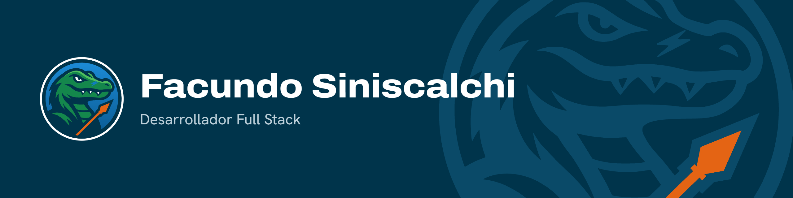
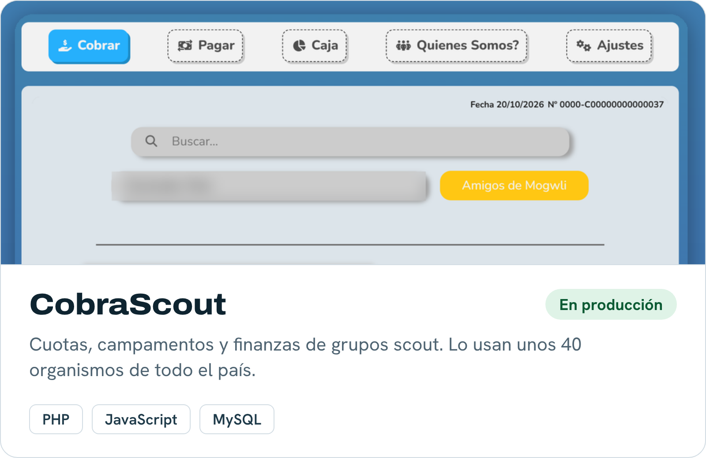
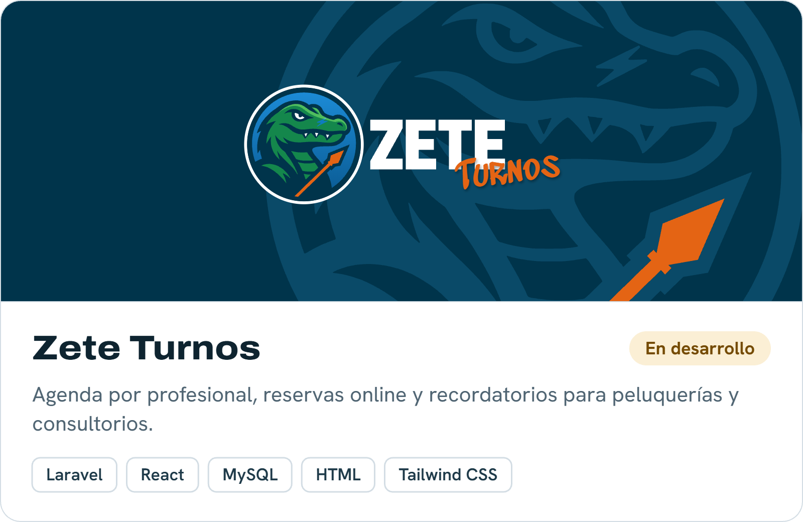
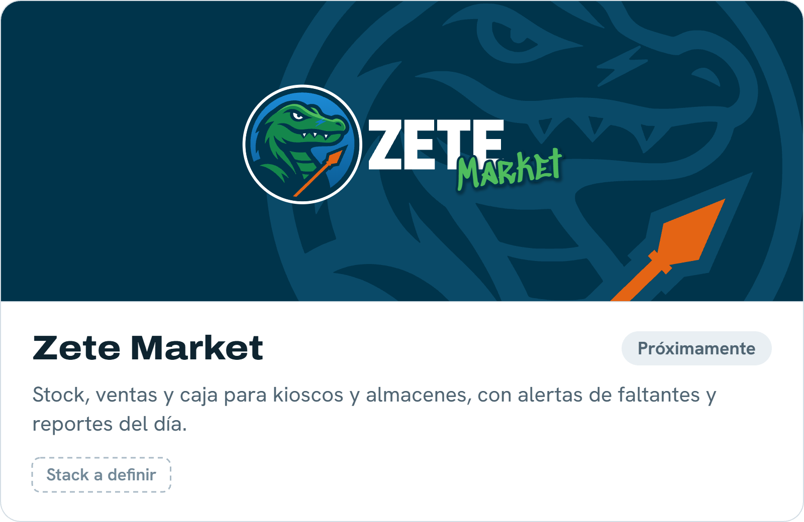
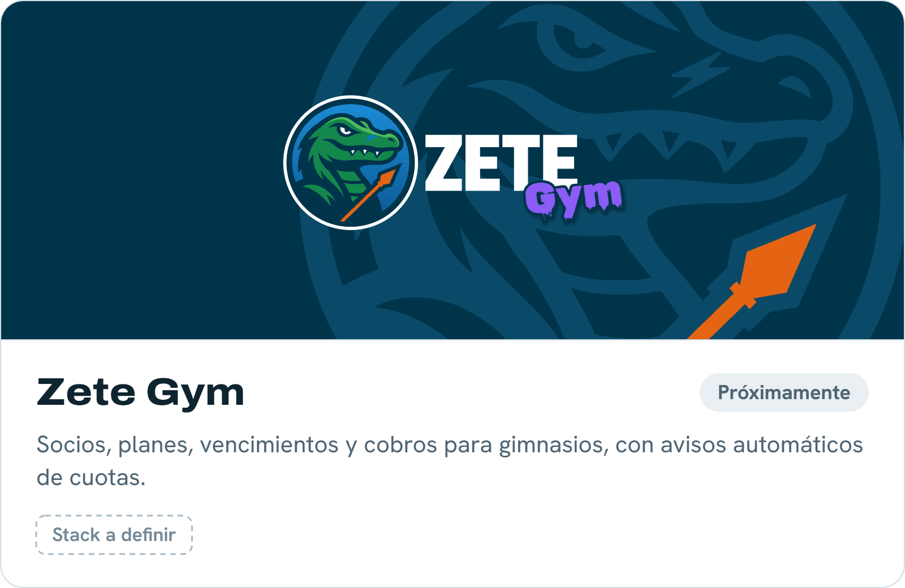
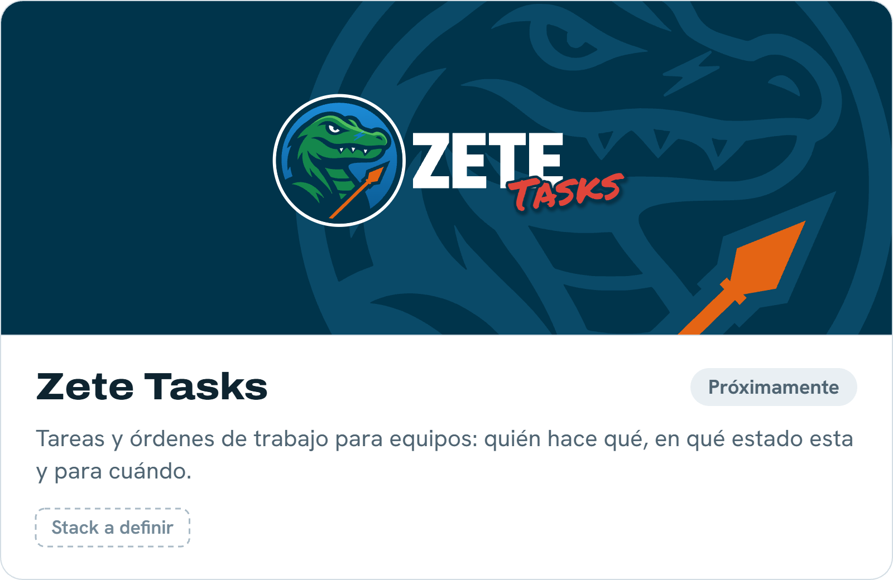
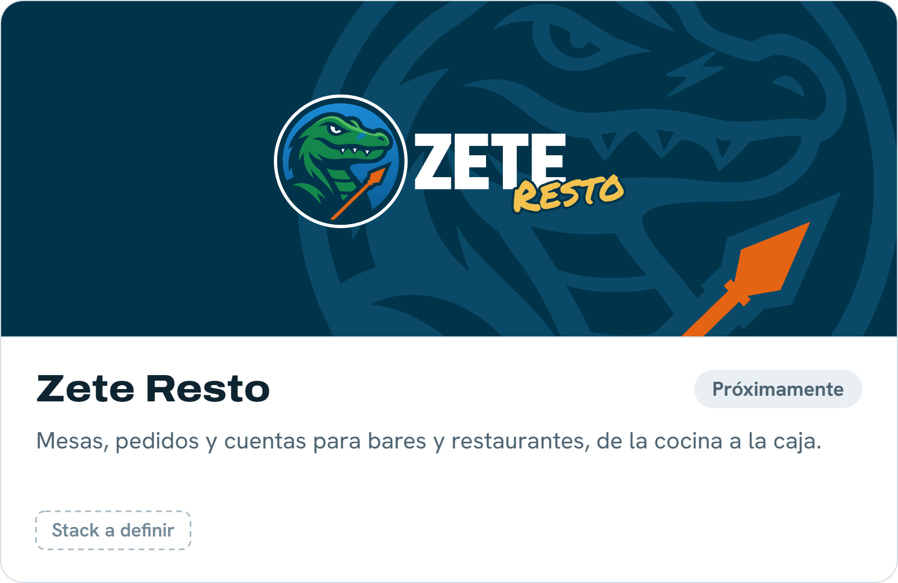

  

## Hola, soy Facundo 👋

Me dedico a hacerle la vida más fácil a negocios y personas, transformando sus tareas diarias en procesos simples y ordenados.

Trabajé 3 años en el ERP de **Millanel Cosmética**, desarrollando en Python y MySQL los paneles de logística y las integraciones con MercadoShops y JumpSeller. En paralelo creé **CobraScout**, un sistema web que hoy usan unos 40 grupos scout de todo el país para manejar sus cuotas, campamentos y finanzas sin papeles ni planillas sueltas.

Ahora estoy armando **Zete**, mi marca de sistemas de gestión para gimnasios, academias y otros negocios.

## 🛠️ Tecnologías

**Las que uso todos los días**

  

**Las que estoy sumando**

  

## 📂 Proyectos

<table>
  <tr>
    <td width="50%">
      
    </td>
    <td width="50%">
      
    </td>
  </tr>
  <tr>
    <td width="50%">
      
    </td>
    <td width="50%">
      
    </td>
  </tr>
  <tr>
    <td width="50%">
      
    </td>
    <td width="50%">
      
    </td>
  </tr>
</table>

## 💼 Experiencia

- **Programador Python, ERP corporativo** · Millanel Cosmética · 2023 – 2026 
  Paneles y reportes de logística, integraciones con APIs de e-commerce y optimización de consultas en MySQL.
- **Desarrollador Full Stack** · CobraScout · 2023 – hoy 
  Desarrollo de la mayor parte del sistema (PHP, JavaScript y MySQL) junto a un equipo de tres personas.

## 📫 Contacto

<b>🇬🇧 English</b>

 

Hi, I'm Facundo, a Full Stack developer from Buenos Aires, Argentina. I like making life easier for businesses and people by turning their daily tasks into simple, organized processes.

I spent 3 years working on the ERP at **Millanel Cosmética** (Python and MySQL: logistics dashboards and integrations with MercadoShops and JumpSeller). I also built **CobraScout**, a web system used by around 40 scout groups across Argentina to manage fees, camps and finances. Now I'm working on **Zete**, my own brand of management systems for gyms, academies and small businesses.

**Stack:** Python, PHP, JavaScript, MySQL, Git, Linux. Currently learning Laravel, React, Node.js and Docker.

